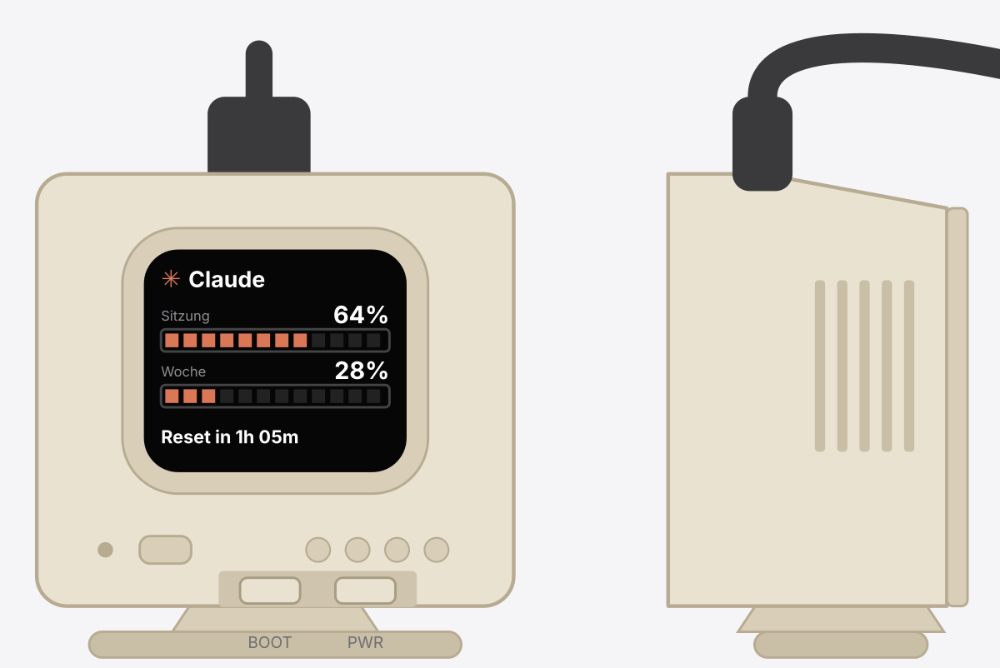

# Claude Usage Monitor 🖥️

🇬🇧 **English** · 🇩🇪 [Deutsch](README.de.md)

**A tiny 90s-style computer monitor for your desk that shows your Claude plan limits.**
Session (5 hours), week (7 days) and when they reset. Battery, USB-C charging, 3D-printed case. About €35, no soldering. Display in English or German.



> **Made for beginners.** No coding, no soldering. Just follow the steps in order.

**🌐 Project page with all downloads and one-click install:** [apirz-ai.github.io/claude-usage-monitor](https://apirz-ai.github.io/claude-usage-monitor/)

## Quick start in 5 steps

| | Step | Time |
|---|---|---|
| 1 | **Buy the parts**: [board](https://www.amazon.de/dp/B0D9PTZ5DY) + [battery](https://www.amazon.de/dp/B0GJSH4J3S) (about €35) | 5 min |
| 2 | **Print the case**: 4 files from `stl/` | about 4 h |
| 3 | **Install the software**: one click on the project page | 2 min |
| 4 | **Assemble**: buttons, board, battery, lid, stand | 10 min |
| 5 | **Connect to Claude**: setup script on your PC, Wi-Fi on the device | 10 min |

Every step is explained below.

## Project status

| Part | Status |
|---|---|
| Parts list | ✅ done |
| Case (STL) | ✅ designed and checked as printable · ⏳ first test print pending |
| Firmware (device) | ⏳ written, **not yet tested on real hardware** |
| iPhone widget | ✅ in daily use |
| Setup script (Windows) | ✅ in daily use |

> 🙋 **Testers wanted!** Already have the parts and want to build it early? Tell us in [Issues](https://github.com/Apirz-AI/claude-usage-monitor/issues) what worked and what didn't. Your findings go into the next version.

> ⚠️ **Unofficial hobby project.** Not made by Anthropic. It uses an undocumented interface that can change or stop working at any time. Use at your own risk.

---

## Contents

1. [Parts](#1-parts)
2. [Print the case](#2-print-the-case)
3. [Assemble](#3-assemble)
4. [Install the software](#4-install-the-software)
5. [Connect to Claude](#5-connect-to-claude)
6. [Usage](#6-usage)
7. [Bonus: iPhone widget](#7-bonus-iphone-widget)
8. [Troubleshooting](#8-troubleshooting)
9. [How it works](#9-how-it-works)
10. [Publish your own copy](#10-publish-your-own-copy)

---

## 1. Parts

| Part | What for | Example (Amazon.de) | approx. |
|---|---|---|---|
| **Waveshare ESP32-S3-LCD-1.69** | Tiny computer with Wi-Fi, display and battery charger built in | [B0D9PTZ5DY](https://www.amazon.de/dp/B0D9PTZ5DY) | €26 |
| **LiPo battery 3.7 V 1000 mAh, type 803040**, plug **MX1.25 / 1.25 mm** | Runs without a cable | [B0GJSH4J3S](https://www.amazon.de/dp/B0GJSH4J3S) | €9 |
| **PLA filament**, one colour (cream, beige or light grey), about 50 g | Case | [B0D7GSSH41](https://www.amazon.de/dp/B0D7GSSH41) | €10 / kg |
| USB-C cable + USB charger | Power and software install | you probably have one | – |
| *"hinten" (rear) variant only:* **90° angled USB-C cable** | Cable exits at the back | [B07T3DH7ND](https://www.amazon.de/dp/B07T3DH7ND) | €4 |

Prices as of November 2026. Outside Germany: search your local store for the same part names.

💡 Schools, makerspaces and libraries often have 3D printers including filament.

**Why this board?** Everything is on it: display, Wi-Fi, USB-C and a charger with **power path**. With USB plugged in the device runs from the cable and charges the battery. Unplug it and the battery takes over without interruption, like a small UPS.

---

## 2. Print the case

Two variants, identical from the front: a small 90s CRT monitor on a stand.

| | **"direkt"** (recommended) | **"hinten"** (rear) |
|---|---|---|
| Cable | plugs in **on top**, straight into the board | exits **at the back** |
| Cable type | any normal USB-C cable | 90° angled USB-C cable |
| Buttons | two knobs **under the screen**, visible from the front | **on top** of the case |
| Size (W × H × D) | about 56 × 57 × 35 mm | about 56 × 61 × 35 mm |

**Files** in [`stl/`](stl/), four per variant:

| Part | "direkt" | "hinten" |
|---|---|---|
| Case | [`usagemonitor_direkt_gehaeuse.stl`](stl/usagemonitor_direkt_gehaeuse.stl) | [`usagemonitor_hinten_gehaeuse.stl`](stl/usagemonitor_hinten_gehaeuse.stl) |
| Back lid | [`usagemonitor_direkt_deckel.stl`](stl/usagemonitor_direkt_deckel.stl) | [`usagemonitor_hinten_deckel.stl`](stl/usagemonitor_hinten_deckel.stl) |
| Stand | [`usagemonitor_direkt_fuss.stl`](stl/usagemonitor_direkt_fuss.stl) | [`usagemonitor_hinten_fuss.stl`](stl/usagemonitor_hinten_fuss.stl) |
| Buttons | [`usagemonitor_direkt_tasten.stl`](stl/usagemonitor_direkt_tasten.stl) (2 pins + 2 knobs) | [`usagemonitor_hinten_tasten.stl`](stl/usagemonitor_hinten_tasten.stl) (2 pins) |

### From file to printer

The **STL file** is the blueprint. A **slicer** cuts it into thin layers and turns it into **G-code**, the instructions for the printer.

1. Find your printer model and open its slicer: [PrusaSlicer](https://www.prusa3d.com/page/prusaslicer_424/), [Bambu Studio](https://bambulab.com/en/download/studio), [Cura](https://ultimaker.com/software/ultimaker-cura/) or [OrcaSlicer](https://github.com/SoftFever/OrcaSlicer).
2. Pick your printer and **PLA**, drag in the four files.
3. Settings: **0.2 mm** layers, **15 %** infill, **no supports**. Case upright, lid and stand flat, buttons standing.
4. **Slice**, save the G-code to SD card / USB stick (or send via Wi-Fi), start and watch the first layer.

**Doesn't fit?** Parts can differ by a few tenths of a millimetre. Measure, then change the values under *MASSE DER BAUTEILE* (part dimensions) in [`enclosure/usagemonitor_gehaeuse.scad`](enclosure/usagemonitor_gehaeuse.scad) with the free [OpenSCAD](https://openscad.org): set `variante` and `teil`, press **F6**, *File → Export → STL*.

---

## 3. Assemble

> Install the software first (section 4) while the board is still easy to reach.

1. **⚠️ Check battery polarity!** The red wire must go to **+** at the `BAT` socket. Cheap batteries are sometimes wired the wrong way round, which can destroy the board. If in doubt, measure.
2. **Buttons:** "direkt": push the pins **from inside** through the floor, then press the two knobs onto the pin ends underneath. "hinten": push the pins in **from the top**.
3. **Insert the board sideways**, screen to the front. "direkt": USB-C points **up** to the opening. "hinten": USB-C points **down**; plug in the angled cable so it points backwards.
4. Check that both buttons click.
5. Plug in the **battery** and lay it flat behind the board (a strip of double-sided tape helps).
6. Push on the **lid**, put the case on the **stand**.

---

## 4. Install the software

This is called **flashing**: putting the software onto the little computer.

1. Connect the device via **USB-C** to your computer.
2. Open the [**project page**](https://apirz-ai.github.io/claude-usage-monitor/) in **Chrome** or **Edge**.
3. Choose your **language**, then click **Connect** at your case variant → select the device → **Install**.
4. Wait for "Installation complete".

**Device not found?** Hold **BOOT**, press **RST** briefly, release BOOT, try again.

**Advanced (Arduino IDE):** board package *esp32* by Espressif, libraries **LovyanGFX**, **ArduinoJson**, **WiFiManager** (tzapu). Open `firmware/UsageMonitor/UsageMonitor.ino`, board **ESP32S3 Dev Module**, *USB CDC On Boot*: Enabled, *Partition Scheme*: Huge APP. Language and screen rotation are set in `config.h`.

---

## 5. Connect to Claude

Each device needs **its own** login, a **refresh token**. Think of it as an ID card the device uses to fetch a fresh day pass again and again. Each time, the old card becomes invalid, so two devices sharing one would lock each other out. Your password never leaves your PC.

**Windows:**

1. Install Claude Code once. Open PowerShell and run:
   ```powershell
   irm https://claude.ai/install.ps1 | iex
   ```
2. Download [`UsageMonitor-Einrichtung.ps1`](setup/UsageMonitor-Einrichtung.ps1) (setup script, speaks English or German) and run it:
   ```powershell
   powershell -ExecutionPolicy Bypass -File "$env:USERPROFILE\Downloads\UsageMonitor-Einrichtung.ps1"
   ```
   *ExecutionPolicy Bypass* allows only this one script, only this once.
3. The script starts Claude Code if needed: answer **"Yes, I trust this folder"**, type `/login` → **Claude account with subscription** → allow in the browser → `/exit`.
4. Choose **[2] device**. The token is now in your clipboard.
5. Turn on the monitor. It shows **"Setup"**.
6. On your phone or laptop, join the Wi-Fi **`UsageMonitor-Setup`**. A page opens (otherwise go to `192.168.4.1`).
7. **Configure WiFi** → pick your Wi-Fi → password → paste the token with **Ctrl + V** → **Save**. Done! 🎉

> 🔒 The token is a key to your Claude account. Never share it or post screenshots of it.

**Mac/Linux:** after logging in with Claude Code, the refresh token is in `~/.claude/.credentials.json` (Mac: Keychain entry "Claude Code-credentials") under `refreshToken`. Paste it in step 7, then rename that file so your computer stops using it.

---

## 6. Usage

| What | How |
|---|---|
| Turn on (battery) | hold **PWR** until the screen lights up |
| Refresh now | press **BOOT** briefly |
| Turn off | hold **BOOT** 3 s, then release |
| Full reset (Wi-Fi + login) | hold **BOOT** 10 s |

The knob, switch and dot on the front of the chin are decoration. Values update every **2 minutes**. Battery life: roughly **10–20 hours**. Bar colours: orange normal, amber from 75 %, red from 90 %.

---

## 7. Bonus: iPhone widget

1. Install the free app **Scriptable**.
2. Save [`widget/ClaudeUsage.js`](widget/ClaudeUsage.js) to **iCloud Drive → Scriptable** (name must be exactly `ClaudeUsage.js`).
3. Run the setup script on your PC → **[1] iPhone widget** → scan the QR code → **Open in Scriptable** → "Connected ✓".
4. Add a Scriptable widget to your Home Screen and pick the script **ClaudeUsage**.

The iPhone also needs its own login: run the script once per device. The widget follows your iPhone language.

---

## 8. Troubleshooting

| Problem | Fix |
|---|---|
| Device turns off right away on battery | Set `BOARD_VERSION` to `1` in `firmware/UsageMonitor/config.h` (older board revision). |
| Screen stays black after install | The pin numbers may differ on your board revision. Compare them with the Waveshare pinout and adjust `config.h`. Please report it in Issues. |
| Colours look inverted | Set `DISPLAY_INVERT` to `false` in `config.h`. |
| Picture upside down | Install the **other** variant on the project page (or switch `DISPLAY_ROTATION` between `1` and `3`). |
| Wrong language | Pick the other language on the project page, or set `LANGUAGE_EN` in `config.h`. |
| USB plug doesn't fit the top opening ("direkt") | Increase `stecker_b` / `stecker_d` in the `.scad` file and reprint. |
| Angled plug doesn't fit ("hinten") | Increase `kabel_platz` (e.g. 13) and reprint. |
| Screen shows **"Login expired"** | The login was used elsewhere. Run the setup script again; the device opens `UsageMonitor-Setup` by itself. |
| **"Wi-Fi lost"** | Check your router. New network: hold BOOT 10 s and set up again. |
| **"No session"** | Normal when no 5-hour window is running. |

---

## 9. How it works

- **ESP32-S3**: a microcontroller, a tiny computer on one chip with Wi-Fi. The brain of the device.
- **API / endpoint**: a fixed web address that returns data instead of a web page, like a vending machine: press a number, get exactly one drink. Here: your limits as numbers.
- **OAuth / token**: instead of your password the device gets an **access token** (day pass, expires after hours) and a **refresh token** (ID card to fetch new day passes).
- **Captive portal**: the setup page that opens by itself when you join `UsageMonitor-Setup`, like hotel Wi-Fi login.
- **SPI / ST7789**: the data line to the display and the display's driver chip.

Every 2 minutes the device fetches a fresh day pass if needed, reads your usage and draws it. The countdown keeps running via internet time (NTP).

**What is what (files)**

| File / folder | What it is | Do you need it? |
|---|---|---|
| `index.html` | Project page: overview, downloads, one-click install | ✅ start here |
| `stl/` | The 8 ready-to-print files (4 per variant) | ✅ for printing |
| `setup/UsageMonitor-Einrichtung.ps1` | Windows script that fetches the Claude login for your device | ✅ once per device |
| `widget/ClaudeUsage.js` | Bonus: same thing as an iPhone widget | optional |
| `firmware/` | Source code of the device software, built automatically and installed via the project page | only to change it |
| `enclosure/` | Case source (OpenSCAD), the STL files are made from it | only to change it |
| `web/` | Project page assets (image, install info) | no |
| `docs/` | Images for this guide | no |
| `.github/` | Build automation: compiles the firmware and generates the print files on every change | no |

---

## 10. Publish your own copy

Click **Fork** at the top right, or create a new repository and upload all files (including the hidden `.github` folder). Then **Settings → Pages → Source: GitHub Actions**. After the green run under **Actions**, your page is at `https://YOURNAME.github.io/claude-usage-monitor/`.

---

## License

MIT, see [LICENSE](LICENSE). Use, change and share freely.

Idea and development: **A.Pirzadeh**

*Claude is a trademark of Anthropic. This project is not affiliated with Anthropic.*
