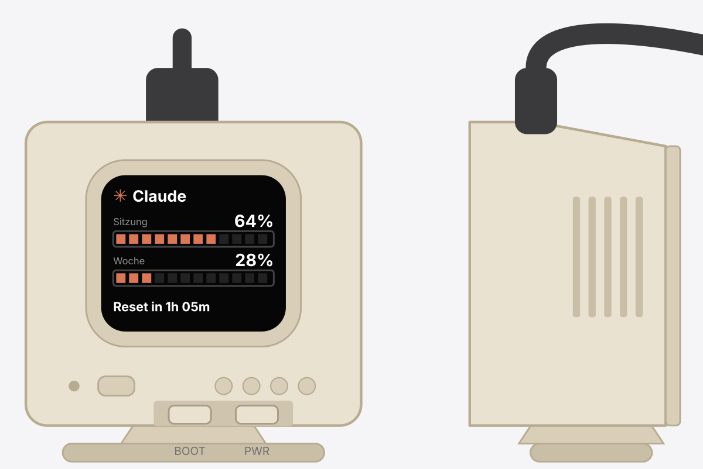
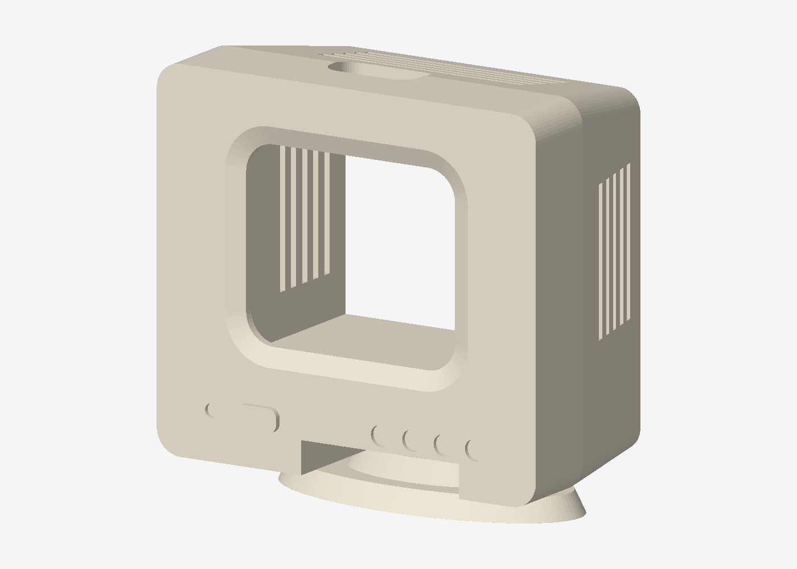

# Claude Usage Monitor 🖥️

🇩🇪 **Deutsch** · 🇬🇧 [English](../en/README.md)

**Ein Mini-Computermonitor im 90er-Retro-Look für den Schreibtisch, der dein Claude-Abo-Limit anzeigt.**
Sitzung (5 Stunden), Woche (7 Tage) und wann es wieder zurückgesetzt wird. Mit Akku, Laden über USB-C, Gehäuse aus dem 3D-Drucker. Kosten: ca. 35 €, kein Löten nötig. Anzeige auf Deutsch oder Englisch.



> **Zwei Varianten, ein Projekt.**
> 🔋 **Mit Akku** (kabellos nutzbar, ca. 35 €): **diese Seite**
> 💶 **Ohne Akku** (Lite, günstiger, ca. 16 €, größeres 2,8-Zoll-Touch-Display): [Claude Usage Monitor Lite](https://github.com/Apirz-AI/claude-usage-monitor-lite) · [Projektseite](https://apirz-ai.github.io/claude-usage-monitor-lite/de/)

> **Für Einsteiger gemacht.** Du musst nicht programmieren und nicht löten können. Folge einfach den Schritten der Reihe nach.

**🌐 Projektseite mit allen Downloads und Ein-Klick-Installation:** [apirz-ai.github.io/claude-usage-monitor](https://apirz-ai.github.io/claude-usage-monitor/de/)

## Schnellstart in 5 Schritten

| | Schritt | Dauer |
|---|---|---|
| 1 | **Teile kaufen**: [Board](https://www.amazon.de/dp/B0D9PTZ5DY) + [Akku](https://www.amazon.de/dp/B0GJSH4J3S) (ca. 35 €) | 5 min |
| 2 | **Gehäuse drucken**: 4 Dateien aus `stl/` in den 3D-Drucker | ca. 4 h |
| 3 | **Software aufspielen**: auf der Projektseite einen Knopf klicken | 2 min |
| 4 | **Zusammenbauen**: Tasten, Board, Akku, Deckel, Fuß | 10 min |
| 5 | **Mit Claude verbinden**: Einrichtungs-Skript am PC, WLAN am Gerät | 10 min |

Jeder Schritt ist unten genau erklärt.

## Projektstand

| Teil | Stand |
|---|---|
| Teileliste | ✅ fertig |
| Gehäuse (STL) | ✅ fertig konstruiert und als druckbar geprüft · ⏳ erster Probedruck steht aus |
| Firmware (Gerät) | ⏳ geschrieben, **noch nicht auf echter Hardware getestet** |
| iPhone-Widget | ✅ läuft im Alltag |
| Einrichtungs-Skript (Windows) | ✅ läuft im Alltag |

> 🙋 **Tester gesucht!** Du hast die Teile schon und baust ihn früher nach? Erzähl uns in [Issues](https://github.com/Apirz-AI/claude-usage-monitor/issues), was geklappt hat und was nicht. Wir übernehmen deine Erkenntnisse in die nächste Version.

> ⚠️ **Inoffizielles Bastelprojekt.** Nicht von Anthropic. Claude Usage Monitor nutzt eine nicht dokumentierte Schnittstelle, die sich jederzeit ändern oder abgeschaltet werden kann. Nutzung auf eigene Verantwortung.

---

## Inhalt

1. [Einkaufsliste](#1-einkaufsliste)
2. [Gehäuse drucken](#2-gehäuse-drucken)
3. [Zusammenbauen](#3-zusammenbauen)
4. [Software aufspielen](#4-software-aufspielen)
5. [Claude-Zugang einrichten](#5-claude-zugang-einrichten)
6. [Bedienung](#6-bedienung)
7. [Bonus: iPhone-Widget](#7-bonus-iphone-widget)
8. [Wenn etwas nicht klappt](#8-wenn-etwas-nicht-klappt)
9. [So funktioniert es (für Neugierige)](#9-so-funktioniert-es)
10. [Eigene Kopie veröffentlichen (GitHub)](#10-projekt-selbst-veröffentlichen)

---

## 1. Einkaufsliste

| Teil | Wofür | Beispiel (Amazon.de) | ca. Preis |
|---|---|---|---|
| **Waveshare ESP32-S3-LCD-1.69** | Mini-Computer mit WLAN **und** Display, Akku-Ladung eingebaut | [B0D9PTZ5DY](https://www.amazon.de/dp/B0D9PTZ5DY) | 26 € |
| **LiPo-Akku 3,7 V 1000 mAh, Typ 803040**, Stecker **MX1.25 / 1,25 mm** | Strom ohne Kabel | [B0GJSH4J3S](https://www.amazon.de/dp/B0GJSH4J3S) | 9 € |
| **PLA-Filament**, eine Farbe (Cremeweiß, Beige oder Hellgrau), z. B. eSUN Matte PLA *Cremeweiß* | Gehäuse (ca. 50 g nötig) | [B0D7GSSH41](https://www.amazon.de/dp/B0D7GSSH41) | 10 € / kg |
| USB-C-Kabel + USB-Netzteil | Strom und Software aufspielen | hast du meistens schon | – |
| *nur Variante „hinten“:* USB-C-Kabel **90° gewinkelt**, 1 m | Kabel kommt hinten aus dem Gerät | [B07T3DH7ND](https://www.amazon.de/dp/B07T3DH7ND) | 3,95 € |

Preise: Stand November 2026. Auf AliExpress oft günstiger, dafür 1–3 Wochen Lieferzeit plus Versand.

💡 **Tipp:** In Schulen, Makerspaces und Bibliotheken gibt es oft 3D-Drucker **mit** Filament. Frag einfach.

**Warum genau dieses Board?** Es hat schon alles drauf: Display, WLAN, USB-C und eine **Lade-Elektronik mit Power-Path**. Das heißt: Steckst du USB-C ein, läuft das Gerät über das Kabel und lädt gleichzeitig den Akku. Ziehst du es ab, übernimmt der Akku ohne Unterbrechung, wie eine kleine USV. **Du musst nichts löten.**

---

## 2. Gehäuse drucken



Es gibt **zwei Varianten**. Beide sehen von vorne gleich aus: ein kleiner 90er-Jahre-Röhrenmonitor mit Standfuß.

| | **„direkt“** (empfohlen) | **„hinten“** |
|---|---|---|
| Kabel | steckt **oben** in einer eingelassenen Mulde, direkt im Board | kommt **hinten** aus dem Deckel |
| Kabel-Art | jedes normale USB-C-Kabel | 90°-gewinkeltes USB-C-Kabel |
| Tasten | zwei Knöpfe in einer Nische **unter dem Kinn**, von vorne sichtbar (wie bei alten Monitoren) | **oben** auf dem Gehäuse |
| Größe (B × H × T) | ca. 56 × 57 × 35 mm | ca. 56 × 61 × 35 mm |

**Dateien:** Im Ordner [`stl/`](stl/) liegen alle Teile druckfertig, je Variante vier Dateien:

| Teil | Variante „direkt“ | Variante „hinten“ |
|---|---|---|
| Gehäuse | [`usagemonitor_direkt_gehaeuse.stl`](stl/usagemonitor_direkt_gehaeuse.stl) | [`usagemonitor_hinten_gehaeuse.stl`](stl/usagemonitor_hinten_gehaeuse.stl) |
| Rückdeckel | [`usagemonitor_direkt_deckel.stl`](stl/usagemonitor_direkt_deckel.stl) | [`usagemonitor_hinten_deckel.stl`](stl/usagemonitor_hinten_deckel.stl) |
| Standfuß | [`usagemonitor_direkt_fuss.stl`](stl/usagemonitor_direkt_fuss.stl) | [`usagemonitor_hinten_fuss.stl`](stl/usagemonitor_hinten_fuss.stl) |
| Tasten | [`usagemonitor_direkt_tasten.stl`](stl/usagemonitor_direkt_tasten.stl) (2 Stifte + 2 Knöpfe) | [`usagemonitor_hinten_tasten.stl`](stl/usagemonitor_hinten_tasten.stl) (2 Stifte) |

Maße anpassen: [OpenSCAD](https://openscad.org) (kostenlos) installieren → `enclosure/usagemonitor_gehaeuse.scad` öffnen → oben `variante` und `teil` einstellen → **F6** → *Datei → Exportieren → STL*.

### So kommt die Datei auf den Drucker (für Einsteiger)

Ein 3D-Drucker kann eine STL-Datei nicht direkt drucken. Dazwischen kommt ein **Slicer**: ein Programm, das das 3D-Modell in hauchdünne Schichten „schneidet“ und daraus die Fahrbefehle für den Drucker macht (**G-Code**). Vergleich: Die STL ist der Bauplan, der G-Code ist die Arbeitsanweisung für den Handwerker.

1. **Druckermodell herausfinden** (steht vorne oder hinten am Drucker, z. B. Prusa MK4, Bambu Lab A1, Creality Ender 3).
2. **Passenden Slicer öffnen** (meist schon auf dem Schul-PC):
   - Prusa → [PrusaSlicer](https://www.prusa3d.com/page/prusaslicer_424/)
   - Bambu Lab → [Bambu Studio](https://bambulab.com/de/download/studio)
   - Creality / Anycubic / andere → [UltiMaker Cura](https://ultimaker.com/software/ultimaker-cura/) oder [OrcaSlicer](https://github.com/SoftFever/OrcaSlicer)
3. Im Slicer oben den **richtigen Drucker** und **PLA** als Material wählen.
4. Die vier STL-Dateien deiner Variante **hineinziehen** (Drag & Drop). Der Slicer verteilt sie auf der Druckplatte. Bei Bedarf auf zwei Druckaufträge aufteilen.
5. Teile richtig **hinlegen** (Tabelle unten). Werkzeug „Auf Fläche legen“ / „Lay on face“ hilft.
6. Einstellungen aus der Tabelle unten setzen, **Stützstrukturen aus**.
7. Auf **„Slicen“** klicken. Der Slicer zeigt Druckzeit und Filamentverbrauch an (ca. 3–4 Stunden, ca. 50 g).
8. **G-Code exportieren**: auf SD-Karte oder USB-Stick speichern, oder bei WLAN-Druckern direkt **„Drucken“**.
9. Am Drucker die Datei auswählen und starten. Die **erste Schicht** beobachten: Haftet sie sauber? Dann läuft der Rest von allein.
10. Nach dem Druck Teile abkühlen lassen und vorsichtig von der Platte lösen.

**Druckeinstellungen:**

| | |
|---|---|
| Material | PLA, alle Teile in **einer Farbe** |
| Schichthöhe | 0,2 mm |
| Füllung | 15 % |
| Stützstrukturen | **keine** |
| Gehäuse | **aufrecht stehend**, Unterseite aufs Druckbett |
| Deckel | flach, die Lippe zeigt nach oben |
| Standfuß | flach, breite Seite unten |
| Tasten-Stifte | stehend, Kappe nach unten |

**Passt nicht?** Bauteile weichen manchmal um ein paar Zehntelmillimeter ab. Miss mit einem Messschieber nach und ändere oben in der `.scad`-Datei die Werte im Abschnitt *MASSE DER BAUTEILE*. Danach neu exportieren.

---

## 3. Zusammenbauen

> Spiel die Software am besten **vorher** auf (Abschnitt 4), solange das Board noch frei zugänglich ist.

1. **⚠️ Akku-Polung prüfen!** Am Board steht neben der Buchse `BAT` ein **+** und ein **–**. Das **rote** Kabel muss zu **+**. Billige Akkus haben den Stecker manchmal falsch herum verdrahtet. Ein falsch gepolter Akku kann das Board sofort zerstören. Im Zweifel mit einem Multimeter messen.
2. **Tasten:**
   - **„direkt“:** Die zwei Stifte **von innen** durch die Löcher im Boden stecken (Kragen liegt innen auf dem Boden). Dann unten in der Nische unter dem Kinn die zwei **Knöpfe** auf die Stiftenden drücken.
   - **„hinten“:** Die zwei Stifte **von oben** in die Löcher stecken (Kappe liegt bündig in der Senkung).
3. **Board quer einsetzen**, Display nach vorne:
   - **„direkt“:** USB-C-Buchse zeigt nach **oben** zur Mulde, Tasten nach **unten** zu den Stiften.
   - **„hinten“:** USB-C-Buchse zeigt nach **unten**, Tasten nach **oben**. Dann das gewinkelte Kabel unten einstecken, so dass es nach hinten zeigt (USB-C passt in beide Richtungen, notfalls umdrehen).
4. Prüfen: Lassen sich beide Stifte fühlbar drücken?
5. **Akku** einstecken und flach hinter das Board legen. Ein Streifen doppelseitiges Klebeband hält ihn sauber.
6. **Deckel** hinten aufstecken (bei „hinten“ vorher das Kabel von unten in den Schlitz schieben). Er hält durch Klemmung.
7. Gehäuse auf den **Standfuß** stecken.

---

## 4. Software aufspielen

Das nennt man **Flashen**: Die Software wird auf den kleinen Computer gespielt. Das ist wie ein Betriebssystem auf einen neuen PC installieren.

### Einfach: im Browser (empfohlen)

1. Gerät per **USB-C** an den Computer stecken.
2. Die [**Projektseite**](https://apirz-ai.github.io/claude-usage-monitor/de/) in **Chrome** oder **Edge** öffnen (Safari und Firefox können das nicht).
3. Beim Knopf **deiner Gehäuse-Variante** („direkt“ oder „hinten“) auf **„Connect“** klicken → das Gerät auswählen → **Install**.
4. Warten, bis „Installation complete“ erscheint. Fertig.

**Wird das Gerät nicht gefunden?** Den **BOOT**-Knopf gedrückt halten, kurz **RST** drücken, BOOT loslassen. Dann noch einmal versuchen.

### Für Fortgeschrittene: Arduino IDE

1. [Arduino IDE](https://www.arduino.cc/en/software) installieren.
2. *Datei → Einstellungen → Zusätzliche Boardverwalter-URLs:*
   `https://espressif.github.io/arduino-esp32/package_esp32_index.json`
3. *Werkzeuge → Board → Boardverwalter*: **esp32** von Espressif installieren.
4. *Bibliotheksverwalter*: **LovyanGFX**, **ArduinoJson** und **WiFiManager** (von tzapu) installieren.
5. `firmware/UsageMonitor/UsageMonitor.ino` öffnen.
6. *Werkzeuge*: Board **ESP32S3 Dev Module**, *USB CDC On Boot*: **Enabled**, *Partition Scheme*: **Huge APP**.
7. Port wählen → **Hochladen** (Pfeil-Symbol).

---

## 5. Claude-Zugang einrichten

Das Gerät braucht einen **eigenen** Zugang zu deinem Claude-Konto, um die Werte abzufragen. Den holst du einmalig am Windows-PC.

> **Warum ein eigener Zugang pro Gerät?** Der Zugang funktioniert mit einem **Refresh-Token**. Das ist wie ein Ausweis, mit dem man sich jeden Tag eine neue Tageskarte holt. Bei jedem Abholen wird der alte Ausweis ungültig und es gibt einen neuen. Nutzen zwei Geräte denselben Ausweis, sperren sie sich gegenseitig aus. Deshalb: **ein Gerät = eine Anmeldung.**

### Schritt für Schritt (Windows)

1. **Claude Code installieren** (einmalig). PowerShell öffnen (Windows-Taste → „PowerShell“ eintippen → Enter) und einfügen:
   ```powershell
   irm https://claude.ai/install.ps1 | iex
   ```
2. **Einrichtungs-Skript** [`UsageMonitor-Einrichtung.ps1`](setup/UsageMonitor-Einrichtung.ps1) herunterladen (auch auf der [Projektseite](https://apirz-ai.github.io/claude-usage-monitor/de/)) und starten:
   ```powershell
   powershell -ExecutionPolicy Bypass -File "$env:USERPROFILE\Downloads\UsageMonitor-Einrichtung.ps1"
   ```
   *ExecutionPolicy Bypass* erlaubt nur **dieses eine** Skript **dieses eine Mal**. Deine Sicherheitseinstellungen bleiben, wie sie sind.
3. Das Skript startet bei Bedarf Claude Code. Dort:
   - Ordnerfrage: **„Yes, I trust this folder“** (das Skript hat dafür einen leeren Ordner angelegt)
   - `/login` eintippen → **„Claude account with subscription“** → im Browser **erlauben**
   - Bei „Login successful“: `/exit` eintippen
4. Im Skript **[2] Usage-Monitor-Gerät** wählen. Der Token liegt jetzt in der Zwischenablage.
5. **Claude Usage Monitor einschalten** (an USB-C anstecken oder PWR-Taste drücken). Auf dem Bildschirm steht **„Einrichtung“**.
6. Mit Handy oder Laptop das WLAN **`UsageMonitor-Setup`** auswählen. Es öffnet sich eine Seite (falls nicht: im Browser `192.168.4.1` aufrufen).
7. **Configure WiFi** → dein WLAN wählen → Passwort eingeben → im Feld **Claude Refresh-Token** mit **Strg + V** einfügen → **Save**.
8. Nach wenigen Sekunden erscheinen deine Werte. Im Skript **Enter** drücken. Fertig! 🎉

> 🔒 **Der Token ist wie ein Schlüssel zu deinem Claude-Konto.** Nicht weitergeben, nicht in Chats oder Screenshots posten.

**Mac/Linux:** Das Skript gibt es bisher nur für Windows. Nach dem Login mit Claude Code steht der Refresh-Token in `~/.claude/.credentials.json` (Mac: im Schlüsselbund, Eintrag „Claude Code-credentials“) unter `refreshToken`. Diesen Wert in Schritt 7 einfügen und die Datei danach umbenennen.

---

## 6. Bedienung

| Was | Wie |
|---|---|
| **Einschalten** (Akku) | **PWR**-Taste gedrückt halten, bis das Display angeht |
| **Sofort neu laden** | **BOOT**-Taste **kurz** drücken |
| **Ausschalten** | **BOOT** **3 Sekunden** halten → loslassen |
| **Alles zurücksetzen** (WLAN + Anmeldung) | **BOOT** **10 Sekunden** halten |

Die echten Tasten sitzen bei „direkt“ als **zwei Knöpfe unter dem Kinn** (von unten nach oben drücken), bei „hinten“ **oben** auf dem Gehäuse. Von vorne gesehen: **PWR** rechts, **BOOT** links bei „direkt“ – bei „hinten“ umgekehrt.
Die Knöpfe, der Schalter und der Punkt **vorne im Kinn** sind nur Deko im Monitor-Stil.

**Anzeige:**
- **Sitzung**: dein 5-Stunden-Limit. Darunter siehst du, wann es zurückgesetzt wird.
- **Woche**: dein 7-Tage-Limit.
- Balkenfarbe: Orange = normal, Gelb-Orange ab 75 %, Rot ab 90 %.
- Oben rechts: Akkustand. „USB“ bedeutet, dass das Gerät am Kabel hängt und lädt bzw. voll ist.
- Die Werte werden alle **2 Minuten** aktualisiert.

**Akkulaufzeit:** WLAN und Display brauchen Strom. Rechne mit ca. **10–20 Stunden** mit 1000 mAh. Gedacht für „mal ohne Kabel“, nicht für wochenlang.

---

## 7. Bonus: iPhone-Widget

Dieselben Werte als Widget auf dem iPhone-Home- oder Sperrbildschirm.

1. App **Scriptable** (kostenlos) aus dem App Store installieren.
2. [`widget/ClaudeUsage.js`](widget/ClaudeUsage.js) aufs iPhone holen und in **iCloud Drive → Scriptable** speichern. Der Name muss genau `ClaudeUsage.js` sein (nicht `.txt`).
3. Am PC das Einrichtungs-Skript starten → **[1] iPhone-Widget** → QR-Code mit der iPhone-Kamera scannen → **„In Scriptable öffnen“** → „Verbunden ✓“.
4. Widget hinzufügen: Homescreen lange drücken → **Bearbeiten** → **Widget hinzufügen** → **Scriptable** → antippen → Script **ClaudeUsage**.

Auch das iPhone braucht eine **eigene** Anmeldung, also das Skript für jedes Gerät einmal starten.

---

## 8. Wenn etwas nicht klappt

| Problem | Lösung |
|---|---|
| PowerShell: *„claude“ wurde nicht erkannt* | Das Einrichtungs-Skript sucht Claude Code selbst. Sonst PowerShell schließen, neu öffnen und erneut versuchen. |
| Download der `.ps1`-Datei wird blockiert | Im Browser „Behalten“ wählen. Oder den Inhalt von der Webseite kopieren und in eine Datei `UsageMonitor-Einrichtung.ps1` speichern. |
| Gerät geht im Akkubetrieb sofort aus | In `firmware/UsageMonitor/config.h` `BOARD_VERSION` auf `1` stellen und neu flashen (ältere Board-Version). |
| Bildschirm bleibt nach der Installation schwarz | Die Pin-Nummern können je nach Board-Version abweichen. Mit der Waveshare-Pinbelegung vergleichen und in `config.h` anpassen. Bitte in den Issues melden. |
| Farben sehen „negativ“ aus | In `config.h` `DISPLAY_INVERT` auf `false` stellen. |
| Anzeige in der falschen Sprache | Den englischen Ordner erwischt? Die Software aus dem Ordner `de/` installieren, oder in `config.h` `LANGUAGE_EN` auf `0` (Deutsch) bzw. `1` (Englisch). |
| Bild steht auf dem Kopf | Auf der Webseite die **andere** Variante aufspielen (oder in `config.h` `DISPLAY_ROTATION` zwischen `1` und `3` wechseln). |
| USB-C-Stecker passt nicht in die obere Mulde („direkt“) | In der `.scad`-Datei `stecker_b` / `stecker_d` größer machen und neu drucken. |
| Gewinkelter USB-Stecker passt nicht rein („hinten“) | In der `.scad`-Datei `kabel_platz` größer machen (z. B. 13) und neu drucken. |
| Anzeige: **„Anmeldung abgelaufen“** | Der Zugang wurde woanders benutzt. Einrichtungs-Skript neu starten, neuen Token holen, Gerät verbindet sich automatisch mit `UsageMonitor-Setup`. |
| Anzeige: **„WLAN getrennt“** | Router prüfen. Neues WLAN: BOOT 10 Sekunden halten und neu einrichten. |
| Sitzung zeigt **„Keine Sitzung“** | Normal, wenn gerade kein 5-Stunden-Fenster läuft. |
| Gehäuse zu eng / zu weit | Maße in der `.scad`-Datei anpassen (Abschnitt 2). |

---

## 9. So funktioniert es

Kurz erklärt, damit du mitreden kannst:

- **ESP32-S3**: Ein Mikrocontroller, also ein winziger Computer auf einem Chip mit eingebautem WLAN. Er ist wie das Gehirn des Geräts.
- **API / Endpunkt**: Eine feste Internetadresse, die Daten statt einer Webseite liefert. Wie ein Automat: Man drückt eine Nummer und bekommt genau ein Getränk. Hier liefert sie dein Limit als Zahlen.
- **OAuth / Token**: Statt deines Passworts bekommt das Gerät einen **Access-Token** (Tageskarte, läuft nach Stunden ab) und einen **Refresh-Token** (Ausweis, um neue Tageskarten zu holen). Dein Passwort verlässt nie deinen PC.
- **Captive Portal**: Die Einrichtungsseite, die sich automatisch öffnet, wenn du dich mit `UsageMonitor-Setup` verbindest. Wie das WLAN-Login im Hotel.
- **SPI / ST7789**: SPI ist die Datenleitung zum Display, ST7789 der Treiber-Chip im Display. Er übersetzt Befehle in Pixel.
- **Power-Path**: Die Lade-Elektronik versorgt das Gerät direkt aus USB und lädt nebenbei den Akku. Ohne USB übernimmt der Akku nahtlos.

**Ablauf:** Alle 2 Minuten holt sich das Gerät bei Bedarf eine neue Tageskarte, fragt damit die Verbrauchswerte ab und zeichnet sie auf das Display. Der Countdown läuft dazwischen über die Internetzeit (NTP) weiter.

**Was ist was? (Dateien im Projekt)**

| Datei / Ordner | Was es ist | Brauchst du es? |
|---|---|---|
| `de/` | Alles auf Deutsch: diese Anleitung und die Projektseite | ✅ Start hier |
| `en/` | Dasselbe auf Englisch | – |
| `stl/` | Die 8 fertigen Druckdateien (je Variante 4 Teile) | ✅ zum Drucken |
| `setup/UsageMonitor-Einrichtung.ps1` | Windows-Skript: holt den Claude-Zugang für dein Gerät | ✅ einmal pro Gerät |
| `widget/ClaudeUsage.js` | Bonus: dasselbe als iPhone-Widget | optional |
| `firmware/` | Der Quellcode der Gerätesoftware. Wird automatisch übersetzt und über die Projektseite aufgespielt | nur zum Ändern |
| `enclosure/` | Die Gehäuse-Quelle (OpenSCAD). Daraus entstehen die STL-Dateien | nur zum Ändern |
| `web/` | Zubehör der Projektseite (Bild, Installations-Infos) | nein |
| `docs/` | Bilder für diese Anleitung | nein |
| `.github/` | Bau-Automatik: übersetzt die Firmware und erzeugt die Druckdateien bei jeder Änderung | nein |

---

## 10. Projekt selbst veröffentlichen

So stellst du eine eigene, angepasste Kopie auf GitHub online (oben rechts **Fork** geht auch). Die Firmware und die STL-Dateien werden dann **automatisch** gebaut.

1. Kostenloses Konto auf [github.com](https://github.com) anlegen.
2. Oben rechts **+ → New repository** → Name `claude-usage-monitor` → **Public** → **Create**.
3. **„uploading an existing file“** anklicken → alle Dateien und Ordner aus diesem Projekt hineinziehen → **Commit changes**.
   Wichtig: Der versteckte Ordner `.github` muss mit hoch. Falls er beim Ziehen fehlt: **Add file → Create new file**, als Namen `.github/workflows/build.yml` eintippen und den Inhalt hineinkopieren.
4. **Settings → Pages → Source: „GitHub Actions“** einstellen.
5. Oben auf **Actions** klicken und warten, bis der Lauf grün ist (ca. 5–10 Minuten).
6. Die Webseite steht dann unter `https://DEINNAME.github.io/claude-usage-monitor/`. Dort sind Browser-Flasher, STL-Dateien und Skript.

---

## Lizenz

MIT, siehe [LICENSE](LICENSE). Du darfst alles nutzen, ändern und weitergeben.

Idee und Entwicklung: **A.Pirzadeh**

*Claude ist eine Marke von Anthropic. Dieses Projekt steht in keiner Verbindung zu Anthropic.*
